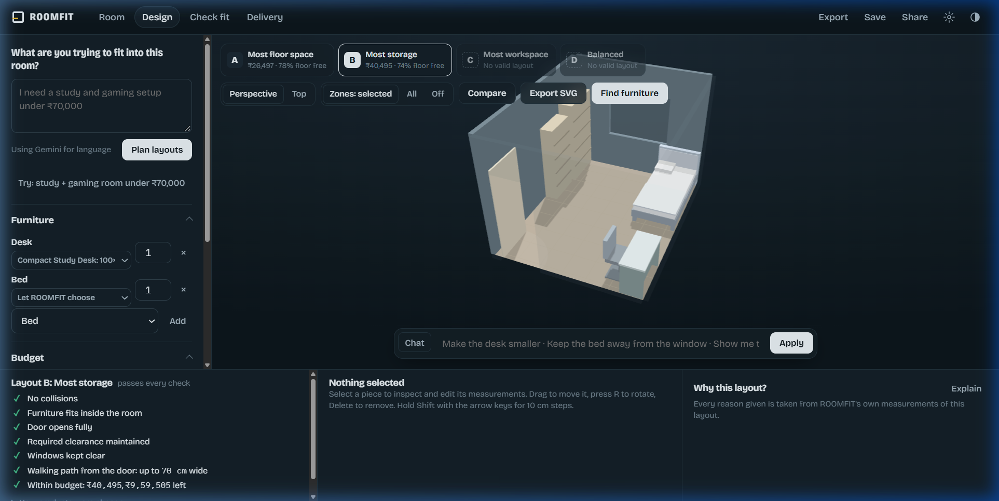
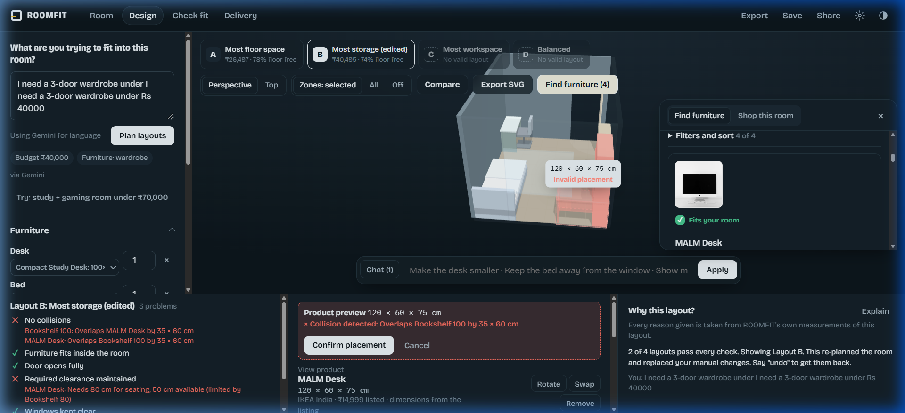
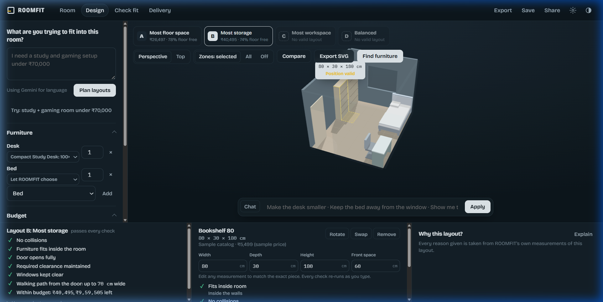
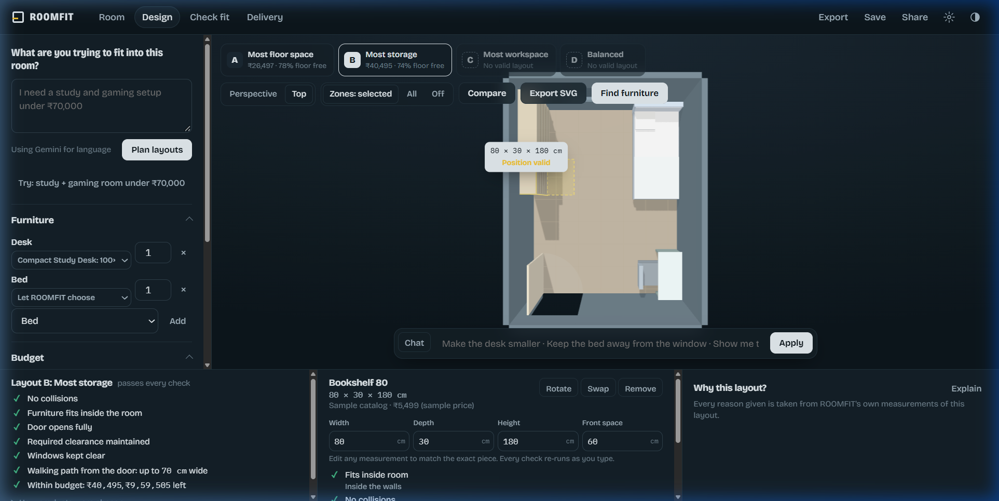
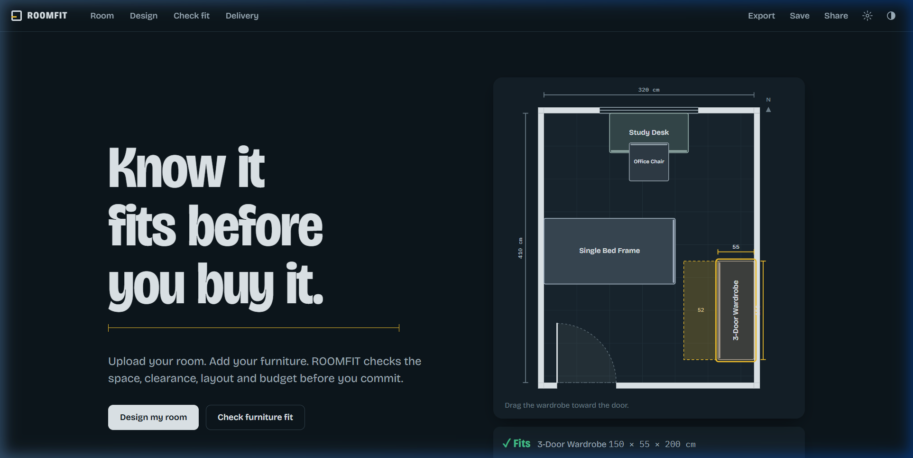
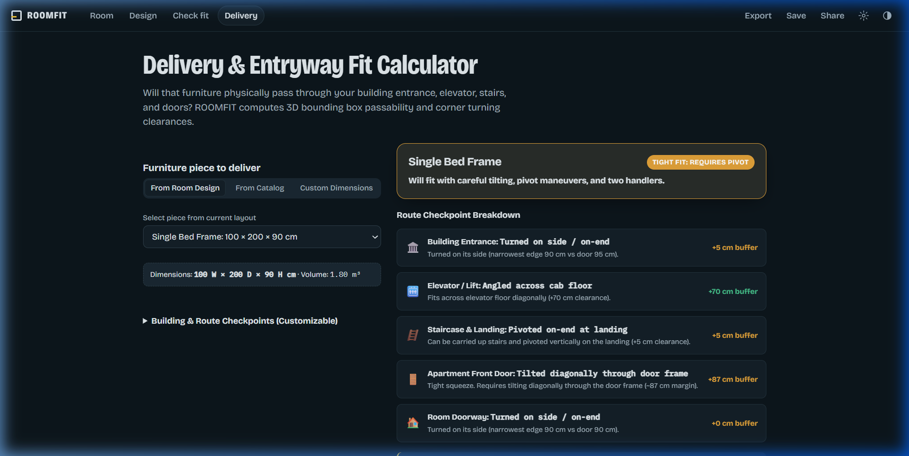

# ROOMFIT

> **Know it physically fits before you buy it.**  
> A spatial planning and live furniture discovery platform that verifies physical fit, door swings, walkway clearances, delivery routes, and budget before you buy.

Plain HTML5, CSS3, and JavaScript with Three.js. No bundler or build step required.

---

## Visual Walkthrough & Working Features

### 1. Interactive 3D Spatial Planning & Optimization
Plan your room in real-time 3D with realistic lighting, procedural furniture meshes, and automated spatial clearance checks. Choose between different layout strategies (Most Floor Space, Most Storage, Most Workspace, Balanced) generated by the constraint-based layout engine.



- **Perspective & Top-Down Camera**: Orbit, pan, zoom, and inspect rooms from any angle.
- **Physical Clearance Zones**: Visual indicators for walking paths, door swing radiuses, and drawer pullouts.
- **Natural Language Design**: Describe your needs (e.g. *"I need a study + gaming setup under ₹70,000"*) and ROOMFIT will synthesize layouts respecting all clearance rules.

---

### 2. Live Furniture Discovery with Actual Product Photos
Search real furniture available in India (from retailers like IKEA India, Pepperfry, Urban Ladder, and Amazon India) with verified dimensions and current INR pricing.



- **Actual Product Photos**: Product listings display isolated, authentic studio catalog photographs of the actual items.
- **Live Fit Badge**: Every product is checked against the measured wall run and clearance before you buy.
- **Direct Retailer Links**: Click *"View product"* to navigate directly to verified retailer search and product pages.

---

### 3. Detailed Spatial Geometry & "Why It Fits" Analysis
ROOMFIT never relies on vague AI estimations for fit verdicts. All measurements are derived from the deterministic 2D/3D geometry engine.



- **Clearance Breakdown**: Door clearance, furniture collision, front space, and walkway width are verified to the centimeter.
- **Shortfall Diagnostics**: If an item does not fit, ROOMFIT reports the exact shortfall (e.g., *"Door clearance: short by 12 cm"*).
- **Dimension Calibration**: Easily enter or adjust width, depth, and height to re-verify physical fit on the fly.

---

### 4. Real-Time Procedural 3D Model Placement
When a product is placed into the room, ROOMFIT renders a procedural 3D model in Three.js matching its exact physical dimensions, color finish, door count, and structure.



- **Dynamic Wardrobe Doors**: Automatically models 2, 3, or 4 door seams, recessed plinths, and handles matching the listed dimensions.
- **Upholstered Beds & Cushioned Sofas**: Generates headboards, pillows, frame depths, and segmented cushions.
- **Real-Time Collision Detection**: Shows immediate visual collision warnings and bounding box tape lines if an item overlaps walls or existing furniture.

---

### 5. Room Setup & Measurement Calibration
Configure room dimensions, walls, doors, windows, and fixed obstacles with centimeter accuracy.



- **Door Swing Direction**: Set inward/outward swings and hinge points to prevent blocking paths.
- **Window Sill Heights**: Validates whether low furniture (like desks) can safely sit under windows.
- **Obstacle Placement**: Account for pillars, radiators, and structural columns.

---

### 6. Delivery Route & Passage Calculator
Verify whether large furniture will physically pass through building entrances, elevators, stairs, and doorways before delivery day.



- **3D Bounding Box Transit**: Evaluates minimum carry dimensions (on-side, on-end, or diagonal tilt).
- **Checkpoint Buffers**: Calculates clearance buffers for building entrances, lift cab floors, stairwell landings, and apartment doors.
- **Maneuver Recommendations**: Advises handlers on pivot maneuvers for tight corners.

---

## Quick Start

### 1. Run the Web Application
No Node build step is needed for the frontend. Serve the files with any static HTTP server:

```powershell
# Using Python
python -m http.server 3000
```
Open **`http://localhost:3000`** in any modern web browser.

### 2. Run the AI Dev Proxy (for Live Furniture Discovery)
ROOMFIT includes a lightweight local proxy for natural language design requests and live product searches:

```powershell
# Install dependencies (only required once)
npm install

# Start the proxy server (runs on port 8787)
node proxy/dev-proxy.js
```
*Make sure your `.env` contains your `GROQ_API_KEY` or `GEMINI_API_KEY`.*

In the app, open **Settings** and ensure the Proxy URL is set to `http://localhost:8787`.

---

## Architecture

```
User Request ──► AI Proxy (Groq / Gemini) ──► Structured Product Data ──► ROOMFIT Geometry Engine ──► Three.js 3D Viewport
                        (Live Retailer Search)               (Sanitized Dimensions & Photos)      (Clearances & Placements)
```

| Component | File | Description |
|---|---|---|
| **Geometry Engine** | `js/engine.js` | Source of truth. Collision detection, door sweeps, circulation graphs, walkway widths, and clearance checks. |
| **3D Viewport** | `js/view3d.js` | Three.js rendering engine: procedural furniture shapes, lighting, shadows, and interactive placement. |
| **Furniture Discovery** | `js/shop.js` | Search orchestration, product sanitization, live retailer URL resolution, and fit validation. |
| **Catalog & Imagery** | `js/catalog.js` | Authentic product imagery resolver for major furniture models, plus fallback catalogs. |
| **Delivery Checker** | `js/delivery.js` | 3D transit passability through doorways, stairways, and elevators. |
| **Spatial Rules** | `js/rules.js` | Clearance tolerances (walkways, door angles, landings, accessibility buffers). |
| **UI Components** | `js/shop-ui.js`, `js/app.js` | Interactive card UI, filter drawers, state persistence, and responsive routing. |
